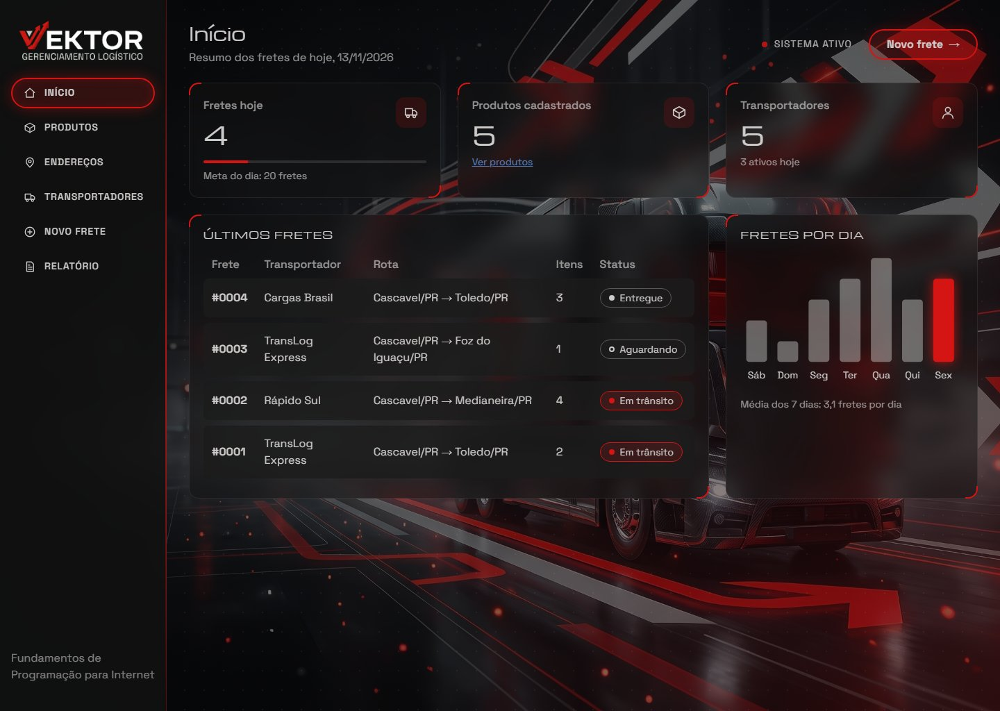
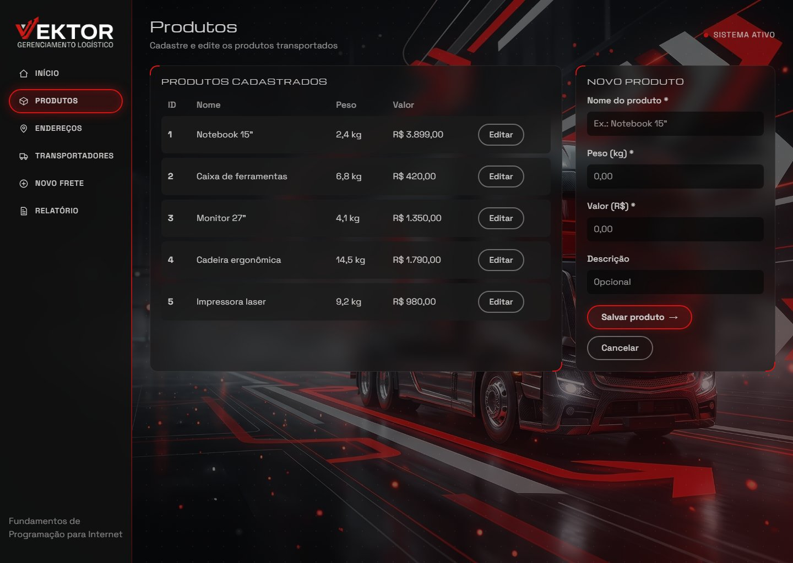
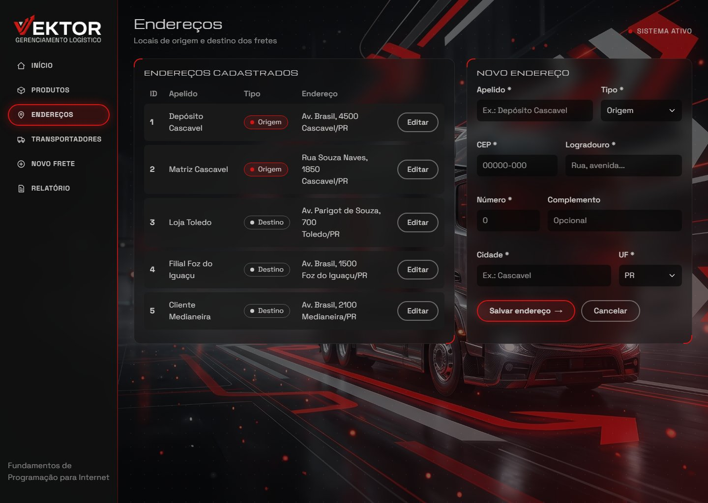
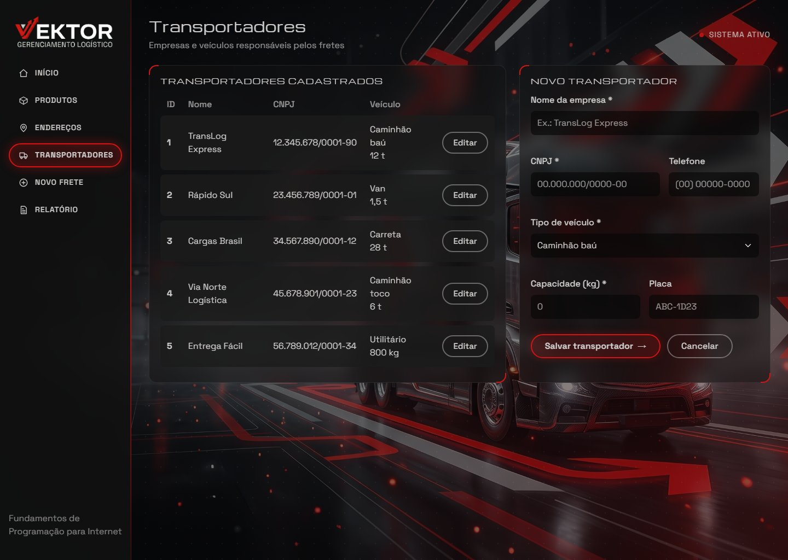
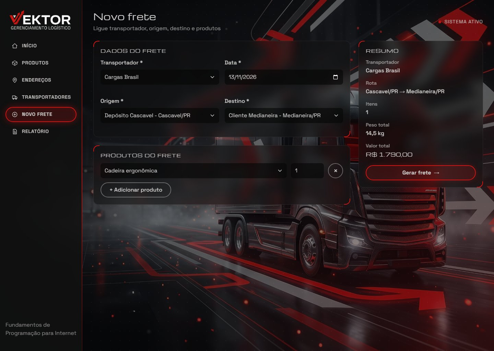
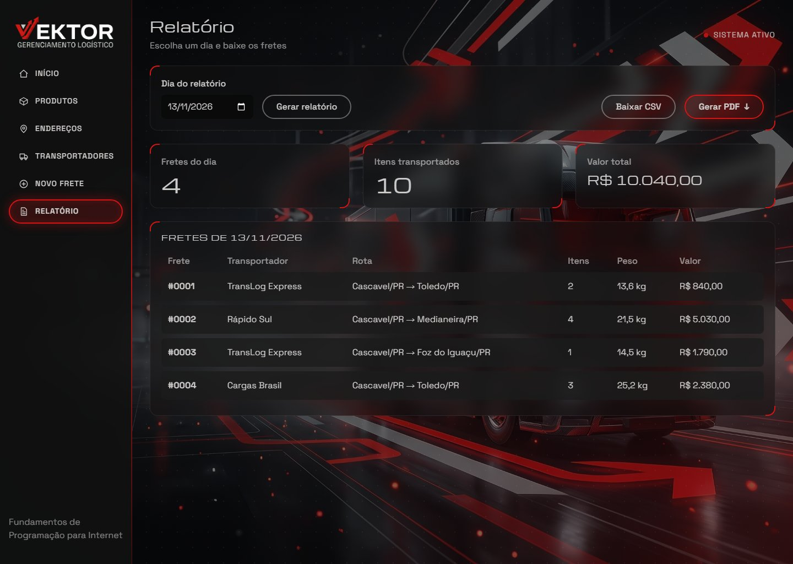

# Vektor - Gerenciamento logístico

Aplicação web de gerenciamento logístico desenvolvida como Atividade Prática Orientada (APO) da disciplina **Fundamentos de Programação para Internet**, da UNIPAR EAD.

**Acadêmico:** Marcos Antonio Sanchez Junior - RA 09062144
**Curso:** Engenharia de Software - Polo de Cascavel (PR)

## Descrição

O Vektor permite cadastrar **produtos**, **endereços** (origem e destino) e **transportadores** e, a partir deles, gerar **fretes**. Um mesmo frete liga um transportador a vários produtos (relação de um para muitos) e confere se o peso total cabe no veículo. Também é possível baixar um relatório dos fretes de um dia, em CSV ou salvando em PDF.

Todos os cadastros têm identificador (id), edição e validação dos campos. Os valores, pesos, datas e status são formatados em PHP.

## Telas

| Início | Produtos |
| --- | --- |
|  |  |

| Endereços | Transportadores |
| --- | --- |
|  |  |

| Novo frete | Relatório |
| --- | --- |
|  |  |

O desenho das telas feito antes da programação (Etapa 1) está em [docs/vektor-etapa1-telas.pdf](docs/vektor-etapa1-telas.pdf).

## Funcionalidades

- **Início:** fretes do dia, produtos e transportadores cadastrados, últimos fretes e gráfico dos últimos 7 dias.
- **Produtos:** lista, cadastro e edição (nome, peso, valor e descrição).
- **Endereços:** lista, cadastro e edição de endereços de origem e de destino.
- **Transportadores:** lista, cadastro e edição (nome, CNPJ, telefone, veículo, capacidade e placa).
- **Novo frete:** escolha de transportador, origem, destino e data; linhas de produto adicionadas e removidas com JavaScript (com opção de desfazer); resumo de itens, peso e valor recalculado na hora; gravação do frete e dos itens em uma transação.
- **Relatório:** fretes de um dia escolhido, com totais, download em CSV e versão para salvar em PDF.

## Tecnologias

- PHP 8 no backend
- MySQL (MariaDB do XAMPP) com PDO e consultas preparadas
- HTML, CSS e JavaScript no frontend
- Bootstrap 5
- XAMPP (Apache e MySQL) no desenvolvimento
- Git e GitHub para versionamento

## Estrutura de pastas

```
vektor/
  index.php            tela Início
  assets/              css, js e imagens
  config/              configuração geral e conexão com o banco
  includes/            cabeçalho, menu, rodapé e funções reutilizadas
  produtos/            lista e gravação de produtos
  enderecos/           lista e gravação de endereços
  transportadores/     lista e gravação de transportadores
  fretes/              novo frete e gravação do frete
  relatorios/          relatório por dia, CSV e impressão
  database/            script das tabelas e dados de exemplo
  docs/                PDF das telas e imagens deste README
```

## Banco de dados

O banco se chama `vektor` e tem cinco tabelas: `produtos`, `enderecos`, `transportadores`, `fretes` e `frete_itens`. A tabela `frete_itens` liga cada frete aos seus produtos e quantidades, e é ela que permite um transportador levar vários produtos no mesmo frete.

## Como executar

1. Instalar o [XAMPP](https://www.apachefriends.org/) e iniciar o **Apache** e o **MySQL** no painel de controle.
2. Copiar a pasta do projeto para `C:\xampp\htdocs\vektor`.
3. Criar o banco e as tabelas, importando `database/schema.sql` no phpMyAdmin (`http://localhost/phpmyadmin`) ou pelo terminal:
   ```
   C:\xampp\mysql\bin\mysql.exe -u root < database\schema.sql
   ```
4. (Opcional) Carregar os dados de exemplo:
   ```
   C:\xampp\mysql\bin\mysql.exe -u root < database\dados_exemplo.sql
   ```
5. Acessar `http://localhost/vektor/`.

A conexão usa o usuário `root` sem senha, que é o padrão do XAMPP no computador local. Se o seu MySQL tiver outra configuração, ajuste o arquivo `config/database.php`.

## Referências

- PHP. **Manual do PHP**. Disponível em: https://www.php.net/manual/pt_BR/.
- W3SCHOOLS. **Referências sobre HTML, CSS, JavaScript e PHP**. Disponível em: https://www.w3schools.com.
- BOOTSTRAP. **Bootstrap 5.3: documentação**. Disponível em: https://getbootstrap.com/docs/5.3/.
- CHACON, Scott; STRAUB, Ben. **Pro Git**. 2. ed. Disponível em: https://git-scm.com/book/pt-br/v2.
- UNIPAR EAD. **Guia didático de Fundamentos de Programação para Internet**: Unidades 1 a 4. Professor Huilson José Lorenzi.
